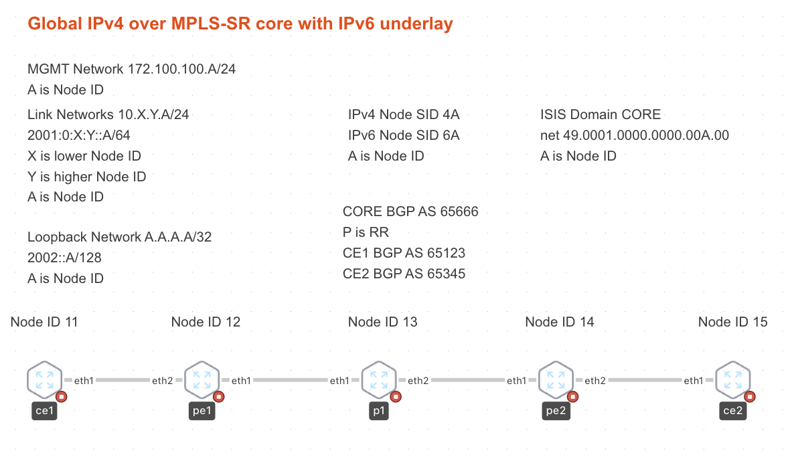

# Global IPv4 over MPLS SR with IPv6 Underlay Lab

*** THIS IS PURELY A LAB FOR DEMO PURPOSES AND SHOULDN'T BE USED IN PRODUCTION WITHOUT FURTHER TESTING ***

This lab demonstrates how IPv4 traffic can be forwarded in the GRT (Global Routing Table) over a MPLS-SR Network running on an IPv6 Underlay.
The underlay network (core interfaces) are running IPv6 only. Also ISIS is IPv6 only. The BGP sessions are IPv6 but exchaning IPv4 NLRIs. 

## Topology




## Usage

To use the lab you need to download the cEOS lab container from arista.com
Import it and label it with arista/ceos:latest or change the topology.clab.yml file

## Verification

CE1 can successfully ping CE2 over the MPLS-SR network

```
CE1#ping 15.15.15.15 source lo 0
PING 15.15.15.15 (15.15.15.15) from 11.11.11.11 : 72(100) bytes of data.
80 bytes from 15.15.15.15: icmp_seq=1 ttl=61 time=2.55 ms
80 bytes from 15.15.15.15: icmp_seq=2 ttl=61 time=1.59 ms
80 bytes from 15.15.15.15: icmp_seq=3 ttl=61 time=1.46 ms
80 bytes from 15.15.15.15: icmp_seq=4 ttl=61 time=1.43 ms
80 bytes from 15.15.15.15: icmp_seq=5 ttl=61 time=1.33 ms

--- 15.15.15.15 ping statistics ---
5 packets transmitted, 5 received, 0% packet loss, time 9ms
rtt min/avg/max/mdev = 1.327/1.672/2.546/0.444 ms, ipg/ewma 2.250/2.088 ms
```

## Links to Resources

- [RFC 5549: IPv4 unicast NLRI with IPv6 next-hop support](https://www.arista.com/en/support/toi/eos-4-23-2f/14436-rfc-5549-ipv4-unicast-nlri-with-ipv6-next-hop-support)